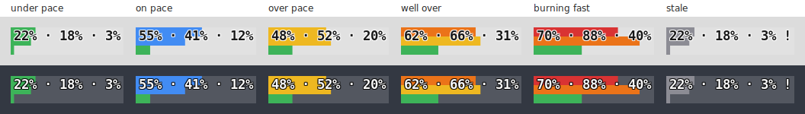
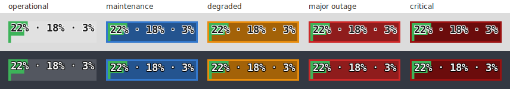

# Claude Quota — XFCE panel widget

A small, efficient XFCE panel widget that shows your **official Claude usage
limits** — the same percentages as the VS Code extension's *Account & usage*
popup: one bar each for the **Session (5hr)**, **Weekly (7 day)** and
**Weekly Fable** windows (configurable) with the percentages drawn over them,
coloured by how fast you're burning through each window, and a click-through
**detailed view** with all
gauges, reset times, a usage-over-time graph, and a per-message event table.
It also flags **Claude's own platform status**, so a wall you hit mid-task is
never ambiguous between "out of quota" and "Claude is down".



---

## Where the data comes from

- **Official percentages** (Session 5hr, Weekly, Weekly Sonnet/Opus, reset
  times) come from Anthropic's OAuth usage endpoint — the same source the
  VS Code popup uses. It is authenticated with the login **Claude Code already
  stores** in `~/.claude/.credentials.json`, so **no API key is needed** and
  there is nothing to configure. Claude Code keeps that token refreshed by
  itself; if it ever expires, the widget shows its last data marked stale
  (`!`) and recovers as soon as you use Claude Code again.
- **History** (the graph and event table in the detailed view) is read from
  Claude Code's local transcripts in `~/.claude/projects/**/*.jsonl` — tokens
  only, no network.
- **Platform status** comes from Claude's public Statuspage roll-up,
  [`status.claude.com/api/v2/status.json`](https://status.claude.com/api/v2/status.json)
  — an unauthenticated ~200-byte static JSON file on a CDN. Only the single
  overall indicator is read (`none` / `maintenance` / `minor` / `major` /
  `critical`) plus its human description; `summary.json` and the per-component
  feeds are deliberately not fetched.

Responses are cached in `~/.cache/xfce-claude-quota/`, so the usage API is
contacted at most once per `api_refresh_seconds` (default 120) and the status
page at most once per `status_refresh_seconds` (default 300) no matter how fast
the panel polls, and network failures degrade to the last known values.

### Rate limiting (429)

`/api/oauth/usage` is an **undocumented, Cloudflare-fronted** internal endpoint:
it publishes no rate-limit headers, there is **no documented request rate**, and
its `429` responses carry only `Retry-After: 0` (i.e. no useful guidance) plus a
generic `rate_limit_error` body. Claude Code itself also polls it, so the limit
is effectively shared. The widget therefore self-throttles:

- one shared schedule for the panel and detail window (via the cache file), so
  they never compound the request rate;
- on a `429`, **exponential backoff** — 2 m → 4 m → 8 m → capped at 15 m —
  reset on the first success (a genuine positive `Retry-After`, if it ever
  appears, is honoured instead);
- the panel keeps showing the last figures with a `!`/`stale — retry in …` note
  until a request gets through.

If you still see frequent 429s, raise **Usage API refresh** (Preferences) to
e.g. 300 s — the 5-hour/weekly window moves slowly, so coarse polling loses
nothing.

None of this applies to the status page: it is public and CDN-served, so it
gets a plain freshness gate plus a 2-minute retry delay after a failure (which
**Refresh now** bypasses — during an outage you want the current status, not the
one from before the last network blip).

## Platform status

When **Claude itself** is degraded, the widget says so — so you can tell "my
weekly limit is gone" apart from "Claude is broken right now".



- The panel image gains a status-coloured **frame**: blue for scheduled
  **maintenance**, orange for a **minor**/partial degradation, red for a
  **major** outage, deep red for **critical**. An indicator this version doesn't
  recognise gets orange — better to under-alarm than to invent an outage. It's
  a frame rather than a background because the bars tile the whole image, and a
  frame still shows when a bar sits at 100 %.
- The bars gain a darker track inside the frame, so they stay readable when a
  bar's own colour is close to the frame's.
- The **tooltip leads with the description** (`⚠ Claude platform: Partially
  Degraded Service`) above the usual gauges.
- The detailed view grows a **banner** at the top with the same description;
  **click it to open <https://status.claude.com>** in your browser.

Nothing is shown while everything is operational — no badge colour, no extra
tooltip line, no banner. A status page the widget *cannot reach* also shows
nothing (or keeps the last indicator it saw): a failure to fetch the status is
never reported as a problem with Claude.

## Why genmon (and not a "real" plugin)?

On XFCE 4.20 there are **no Python bindings for `libxfce4panel`** (only
`Libxfce4ui` / `Libxfce4util` ship a GIR), and external plugins are loaded as
compiled GModule `.so` files — so a *native* panel plugin can't be written in
Python. The documented, supported way to put a custom widget in the panel is
the **Generic Monitor (`genmon`)** plugin, which runs a command on an interval
and renders its output. This widget is that command: it draws the stacked-bars
image itself with Cairo and hands genmon an ``, a tooltip, and click
actions. The GTK windows (detail + preferences) launch only on demand, so each
panel refresh stays cheap (~0.2 s, mostly interpreter startup).

---

## Requirements

- Xubuntu / XFCE 4.20 (tested on 4.20.7)
- `xfce4-genmon-plugin`
- `python3`, `python3-cairo` (pycairo)
- `python3-gi`, `gir1.2-gtk-3.0`, `python3-gi-cairo` (for the detail/prefs windows)

```bash
sudo apt install xfce4-genmon-plugin python3-gi gir1.2-gtk-3.0 python3-cairo python3-gi-cairo
```

## Install

```bash
cd xfce-claude-quota
./install.sh
```

The installer checks dependencies, writes a default config, indexes your
existing history, and adds a menu launcher for the detailed view. It does
**not** touch your panel — add the item yourself (4 clicks):

1. Right-click the panel → **Panel → Add New Items…**
2. Choose **Generic Monitor** → **Add**.
3. Right-click the new item → **Properties**.
4. Set:
   - **Command:** `python3 /full/path/to/xfce-claude-quota.py`
     (get it exactly with `--print-genmon-command`)
   - **Period:** `15` (seconds — how often the panel redraws)
   - **Label:** clear it / untick *Display label*

**Left-click** the widget to open the detailed view (single-instance — a
second click focuses the existing window).

## Using it

- **Panel:** one bar each for Session (5hr), Weekly (7 day) and Weekly Fable by
  default (configurable — see *Which bars*). The bars **tile the whole image**
  edge to edge, as full-width rows on a normal panel or full-height columns on
  a tall one (see *Bar direction*), and the percentages (`12% · 4% · 3%`) are
  drawn **over** them in your Generic Monitor *Font* (see "Making the numbers
  bigger"), with a halo so they stay legible against any fill. Bars are
  coloured by **burn rate** — green under pace, blue on pace, yellow/orange/red
  as you outrun the clock (see *Bar colours*); gray + `!` means the data is
  stale (network/auth hiccup). Hover for a tooltip with all gauges, reset times
  and pace. A coloured frame around the image means *Claude* is degraded — see
  *Platform status*.
- **Detailed view:** every gauge with its reset countdown and pace (mirrors the
  VS Code popup, including per-model weekly buckets when present), with your
  plan in the window title and a *Manage usage on claude.ai* link. The
  **Recent activity** button reveals your local activity — token graph with a
  range selector (6 h / 24 h / 7 d / 30 d) and a per-message table (time,
  model, input/output/cache/total tokens); it starts hidden each time the
  window opens. Auto-refreshes every 30 s, and shows a click-through
  platform-status banner when Claude is degraded. Each bar also carries a time
  scale — see *Reading the detail bars*.

### Reading the detail bars

The horizontal axis of each bar in the detailed view is the quota window as
well as the quota: the window opens at the left edge and resets at the right.

- **Tick marks** divide the window into whole hours (5-hour session: four
  ticks) or days (7-day buckets: six ticks).
- **The triangle** below the bar sits at the fraction of the window that has
  elapsed, which is where the fill would end if you were spending exactly on
  pace. Fill that runs past the triangle is over pace, and the gap is how far;
  fill that stops short of it is under. Hover the bar for the elapsed
  percentage.
- **Durations** in the line under the bar — `Resets in 3d 5h`, `catch up in
  14h 58m` — show the actual date and time they point to when you hover them.

This complements the `~136% by reset` text rather than duplicating it: the
triangle is the raw position on the clock, while the percentage is a projection
smoothed early in a window (see *Bar colours*), so the two agree on direction
but not to the digit. Without a reset time there is no way to place "now" in
the window, so a gauge like that keeps its ticks but gets no triangle.

## Configuration

Preferences (button in the detailed view, or `xfce-claude-quota.py --config`):

| Setting | Meaning |
|---|---|
| **Claude data directory** | Where Claude Code stores credentials + transcripts (default `~/.claude`). |
| **Usage API refresh (seconds)** | Minimum time between calls to the usage endpoint (default 120). Raise it (e.g. 300) if you hit 429s — see *Rate limiting*. |
| **Platform status refresh (seconds)** | Minimum time between `status.claude.com` fetches (default 300). |
| **Panel number font** | `auto` follows the Generic Monitor item's own *Font* setting; or set a Pango font like `Sans Bold 14`. |
| **Panel number colour** | `auto`/`dark` = dark text with a light halo (good on a light panel); `light` = the reverse for dark panels; or a `#rrggbb` hex. The numbers carry a halo, so they stay legible over any bar fill. |
| **Panel image height** | `auto` works it out from the panel the item lives on — *Row size* × the rows the item spans (see *Panel height detection*); or set pixels to override. |
| **Panel image width** | `auto` (fit the numbers) or pixels. |
| **Bar colours** | *Burn rate vs. the window clock* (default) or *Usage percentage only* — the old flat blue / amber ≥ 70 % / red ≥ 90 % scheme. See *Bar colours*. |
| **Panel bars** | Comma-separated bucket keys that get a bar, in order (default `five_hour,seven_day,seven_day_fable`). See *Which bars*. |
| **Panel bar direction** | *Auto* (default) picks horizontal or vertical from the shape of the rendered image; *Always horizontal* / *Always vertical* pin it. See *Bar direction*. |

### Which bars

**Panel bars** is a comma-separated list of bucket keys, drawn in the order
given; the default is `five_hour,seven_day,seven_day_fable`. Keys the API isn't
currently returning are skipped rather than drawn empty, so a machine with no
Fable usage simply gets two bars. If *none* of the listed keys are present, the
first three gauges in the response are shown instead. `--self-test` prints both the keys in use and
every key the response carries, which is how you find the name of a bucket you
want to add (per-model weekly buckets are named after the model, e.g.
`seven_day_opus`).

The tooltip and the detailed view always list *every* gauge — this setting only
controls the panel image.

### Bar direction

A bar reads as a bar while it is several times longer than it is thick. On a
tall panel a full-width row isn't: the image keeps the width the percentages
need while the height grows, so the rows inflate into blobs. On *auto* the
widget stands them up as columns when that happens — side by side, filling from
the bottom, in the same left-to-right order the percentages are written in.

The switch is decided from the rendered geometry, not from the panel height
alone, because the **genmon font matters as much as the panel does**: a large
font makes the image wider, which keeps rows long enough to work on a panel
where a small font would have squashed them. Both shapes have to earn it — the
rows must have fallen below about 4.5:1 *and* the columns must come out at
least 1.6:1 — so a panel that suits neither is left horizontal rather than
swapped for something worse. More bars shifts the balance towards columns,
since each row gets a correspondingly thinner slice of the height.

Bar edges are snapped to whole pixels so neighbours meet exactly rather than
leaving an antialiased seam.

### Panel height detection

With **Panel image height** on `auto` the widget reads the panel's geometry out
of `xfce4-panel.xml`. An xfce4-panel's `size` is the height of **one row**, and
a panel with `nrows` rows is that many times thicker; a plugin either keeps to
one row or spans them all, which for genmon is its `enable-single-row` setting.
So the usable height is `size` for a single-row item and `size × nrows` for a
spanning one. Heights are clamped to 16–256 px.

If the widget comes out too small — bars that don't fill the panel, and *auto*
bar direction staying horizontal when it obviously shouldn't — that detection
is what to check:

```bash
python3 xfce-claude-quota.py --self-test
```

It prints the panel item it matched, the row size, the row count, how many rows
the item spans and the height it will render at. If any of that is wrong (or
the item isn't found at all — the match is by script filename in the genmon
command, and an unmatched item renders at 28 px in `Sans 11`), set **Panel
image height** to an explicit pixel value in Preferences and it will be used
as-is (still clamped to 16–256 px).

### Bar colours

By default a bar is coloured by how fast you are spending the window, not by
how much is gone. Halfway through a 5-hour session with half the quota used is
a sustainable pace, and paints blue; the same 50 % ten minutes in does not.

Each gauge is projected forward: divide the share of quota used by the share of
the window elapsed, and you get the utilization you would land on at reset.

| Projected at reset | Colour | Reading |
|---|---|---|
| < 85 % | 🟢 green | Under pace — you will finish with room to spare. |
| 85–105 % | 🔵 blue | On pace — you will finish about level with the limit. |
| 105–135 % | 🟡 yellow | Over pace — you would want up to a third more quota. |
| 135–190 % | 🟠 orange | Well over — you run dry with a good part of the window left. |
| ≥ 190 % | 🔴 red | Burning at twice the sustainable rate or worse. |

**Pace decides the colour.** A bar that is behind the clock is not in trouble
however full it looks: at 90 % used with 2½ hours left of a 7-day window you
will reach the reset with quota to spare, and the bar is blue. The triangle in
the detailed view shows the same thing — fill at or behind it can never be
warmer than blue.

Two guards keep the projection honest:

- **A smoothing allowance** (8 % of the window and of the quota) is added to
  both sides of the ratio. Without it the projection is meaningless in the
  opening minutes — 2 % used three minutes into a five-hour window
  extrapolates to 200 % — and the bar would flash red on the first prompt of
  every session. Below **5 %** of the quota, pace is ignored entirely.
- **A spent quota is red.** At 100 % you are locked out, which is a fact rather
  than a forecast, so the bar is red whatever the clock says.

The text under each bar comes from the same computation as the colour, so the
two can never disagree: `under pace` / `on pace` / `over pace (~150% by
reset)`, or `nearly exhausted` when the quota is spent.

An over-pace bar also says how long it would take to get back: `over pace
(~120% by reset), catch up in 14h 58m`. That is the time until the bar reads
*on pace* (and turns blue) **if you stop using that quota right now** — usage
stays put while the window clock catches up with it. Any further use pushes it
out. It always lands before the reset.

**A caveat worth knowing:** the projection is a *whole-window average*, so it
gets less sensitive the further into a window you are. With four of five hours
gone, a hard sprint in the last hour barely moves it — the denominator has
already grown too large. Late in a window, trust the percentage and the reset
countdown over the pace verdict.

A gauge whose pace can't be computed — no usable `resets_at`, or a window
length the widget doesn't know — falls back to colouring by raw percentage
(yellow ≥ 75 %, orange ≥ 85 %, red ≥ 95 %) and says `running low` / `very low`
/ `nearly exhausted`.

Setting **Bar colours** to *Usage percentage only* switches every bar to a
simpler, separate scheme — blue, amber at ≥ 70 %, red at ≥ 90 % — and drops the
pace text entirely.

### Which gauges appear

The usage endpoint describes the same limits twice: as a flat map of bucket
keys, and as a structured `limits` array (`kind`, `group`, `percent`,
`resets_at`, `scope`). The widget reads the **array**, because:

- it carries the **per-model weekly buckets**, which the flat keys no longer
  populate — `seven_day_sonnet` / `seven_day_opus` now arrive `null` while the
  corresponding scoped entry is live;
- `group` says how long a window runs, which is what the pace maths needs;
- it keeps the response's **unlaunched codename buckets** out of the display.
  The flat map is padded with placeholders (`nimbus_quill`, `cinder_cove`,
  `tangelo`, `juniper_tide`, `iguana_necktie`, …) that are mostly `null` but
  occasionally arrive as a real `0 %` object, and one of those would otherwise
  show up as a gauge called "Nimbus Quill".

A scoped entry is labelled from its scope — `Weekly Fable`, `Weekly Opus ·
Cowork` — and keyed to match the legacy names (`seven_day_opus`,
`seven_day_opus_cowork`), so the same **Panel bars** keys work whichever source
the gauges came from.

If a response has no usable `limits` array the widget falls back to the flat
map, skipping unknown buckets that are at 0 % *and* have no reset time.

### Making the numbers bigger

The numbers render in the **font you pick in the Generic Monitor item's own
Properties dialog** (the widget reads that choice from the panel config and
draws with it — genmon's font picker otherwise has no visible effect on an
image widget). So: right-click the panel item → *Properties* → **Font**, choose
e.g. *Source Code Pro 16*. The numbers are drawn at that size over the bars,
which always fill the whole image; they're only scaled down if the font is
taller than the image (or wider than a fixed **Panel image width**). The ceiling
is the item's height, so if you want them even bigger, make the panel taller
(right-click panel → *Panel → Panel Preferences → Measurement → Row size*).
With the font left unset in genmon, `Sans 11` is used.

The **panel redraw rate** is genmon's own *Period* setting (step 4 above).
Config lives at `~/.config/xfce-claude-quota/config.ini`.

## Troubleshooting

- **`Claude n/a` in the panel:** hover for the reason. Usually the data
  directory is wrong, or you've never logged in via Claude Code on this
  machine. In this state a click opens Preferences rather than the detailed
  view. Run `python3 xfce-claude-quota.py --self-test` for a full report.
- **Gray bars with `!`:** stale data — network down, token expired, or
  rate-limited (the tooltip says which, and when it'll retry). It heals on its
  own; using Claude Code once refreshes an expired token. For repeated 429s see
  *Rate limiting* above.
- **A coloured border appeared around the widget:** that *frame* is Claude's
  own platform status, not your quota — hover for the description,
  or open the detailed view and click the banner for
  <https://status.claude.com>. See *Platform status*. A single coloured *bar*
  is your burn rate — see *Bar colours*.
- **A bar goes red early in a session:** that is the point — it means the
  current rate would exhaust the window well before it resets, not that you are
  nearly out. The tooltip spells out the projection ("over pace (~210% by
  reset)"). If you'd rather colour by raw percentage, set **Bar colours** to
  *Usage percentage only* in Preferences.
- **A gauge with an odd codename ("Nimbus Quill"):** shouldn't happen any more
  — the widget reads the `limits` array, not the flat bucket map. If one turns
  up it means the response had no usable `limits` and the fallback ran; check
  `--self-test`, and see *Which gauges appear*.
- **Clicking does nothing:** the click runs `python3 xfce-claude-quota.py
  --detail`; run that in a terminal to see the error (usually missing
  `python3-gi` / `gir1.2-gtk-3.0`). The widget emits genmon's `<click>` tag,
  which is what image widgets respond to (`<txtclick>` only covers text).
- **The widget is far smaller than the panel:** the panel height came out
  wrong. Run `--self-test` and look at the *panel item* block — see *Panel
  height detection*. Multi-row panels are the usual cause.
- **Numbers low-contrast / colour-fringed:** the default is dark text with a
  light halo and grayscale anti-aliasing, tuned for a light-grey panel. On a
  dark panel set **Panel number colour** to `light` (or a `#rrggbb`) in
  Preferences.

```bash
python3 xfce-claude-quota.py --self-test   # gauges + history stats, no GUI
python3 xfce-claude-quota.py --reindex     # wipe + rebuild the history cache, then self-test
```

## Files & uninstall

State written: `~/.config/xfce-claude-quota/config.ini`,
`~/.cache/xfce-claude-quota/` (history db, cached usage, cached platform
status, panel image),
`~/.local/share/applications/xfce-claude-quota.desktop`.

Remove the Generic Monitor item from the panel, then:

```bash
rm -rf ~/.config/xfce-claude-quota ~/.cache/xfce-claude-quota
rm -f ~/.local/share/applications/xfce-claude-quota.desktop
```

## License

MIT — see [LICENSE](LICENSE).
